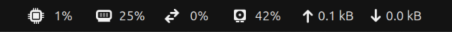
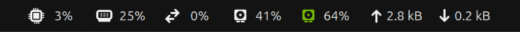

# Panel Stats

A GNOME Shell extension that shows CPU, memory, swap, GPU and network usage in the top bar.

It is a fork of the System Monitor extension from
[gnome-shell-extensions](https://gitlab.gnome.org/GNOME/gnome-shell-extensions) 50.0, written
by Florian Müllner. Two things differ:

- there are GPU sections
- the indicator no longer hides itself when GNOME System Monitor is not installed; the menu
  opens Resources, Mission Center or GNOME Usage instead, whichever is there

## GPU sections

- The integrated GPU has a section that is always there.
- A second section with a green icon appears while the NVIDIA card is awake, and goes away
  when the card suspends.

| NVIDIA card asleep | NVIDIA card awake |
| --- | --- |
|  |  |

A glance therefore shows both whether the NVIDIA card is powered and which GPU is doing the
work. An application that merely wakes the card, without rendering on it, shows up as an
NVIDIA section at 0%.

### The NVIDIA card is not kept awake

On a hybrid graphics laptop the NVIDIA card suspends when nothing uses it. Its load can only
be read with `nvidia-smi`, and every `nvidia-smi` run wakes a sleeping card and holds an awake
one up for a few more seconds. A monitor that polls it every second keeps the card powered for
good. Panel Stats avoids that:

- A card that is suspended, suspending or resuming is never queried. Its power state comes
  from sysfs (`power/runtime_status`), which does not touch the card.
- A card that has just woken up is queried once per second for ten seconds. That is when
  the application that woke it starts to render, and it costs nothing: after a wake-up the
  card stays up for about 20 seconds by itself.
- After that, a card that reports load is queried once per second, and a card that reports
  no load once every 20 seconds, which leaves it room to suspend.

Measured on the machine below, the extension did not delay the card going back to sleep:
after a wake-up without a client the card suspended 20 s later with and without the
extension sampling, and after a rendering client exited it suspended 10 s later without a
single query in between.

### The integrated GPU's load is averaged

The integrated GPU's load comes from sysfs (`gpu_busy_percent`). That file covers a very short
moment: on a lightly used desktop about half of the readings are 0 and the rest are scattered
up to 100, so one reading per second jumps between unrelated values. Panel Stats reads it five
times per second and shows the mean of the last three seconds. On a 60 second recording that
brought the average change between two consecutive values from 44 points down to 5.5. One
reading takes about 20 microseconds.

## Requirements

- GNOME Shell 50
- `gir1.2-gtop-2.0` (Debian and Ubuntu name), like the original extension
- for the NVIDIA load: the `nvidia` kernel module and `nvidia-smi`
- for the integrated GPU's load: a driver that exposes `gpu_busy_percent`, which is amdgpu

A section is only shown for a GPU whose load can be read.

Tested on one machine: ASUS ROG Strix G18, Ubuntu 26.04, AMD Radeon 610M and RTX 5060 Laptop
GPU, NVIDIA driver 595, Wayland session.

## Installation

```
git clone https://github.com/kemalasliyuksek/panel-stats.git
cd panel-stats
just install
```

`just install` compiles the settings schema and symlinks `src/` into
`~/.local/share/gnome-shell/extensions/`. Log out and back in (on Wayland GNOME Shell only
picks up new extensions at login), then:

```
gnome-extensions enable panel-stats@kemalasliyuksek.com
```

Disable the original System Monitor extension if it is enabled, otherwise both show up.

## Limitations

- Intel integrated GPUs do not expose their load in sysfs. An Intel and NVIDIA laptop only
  gets the NVIDIA section, while the card is awake.
- The 20 second gap assumes that an idle NVIDIA card suspends within 20 seconds. That holds
  for driver 595 on the test machine; other drivers have not been measured.
- A workload that starts on a card that has been awake and idle for more than ten seconds
  can take up to 20 seconds to show.
- The integrated GPU's number is a three second mean, so it trails a sudden change by a
  second or two.
- With an AMD integrated and an AMD discrete GPU only the boot GPU is shown.

## Development

`src/gpu.js` does not depend on GNOME Shell.

```
just check     # syntax check and unit tests
just sample    # print what the GPU sections would show, once per second
```

In the `just sample` output a `*` marks the seconds in which `nvidia-smi` ran, next to the
card's power state.

Shell log: `journalctl --user -f -o cat /usr/bin/gnome-shell`.

## About this project

The idea, design and decisions are mine. Most of the code was written with Claude Code;
I reviewed and tested every change on my own machine.

## License

GPL-2.0-or-later, like the extension it is forked from. See [LICENSE](LICENSE).
